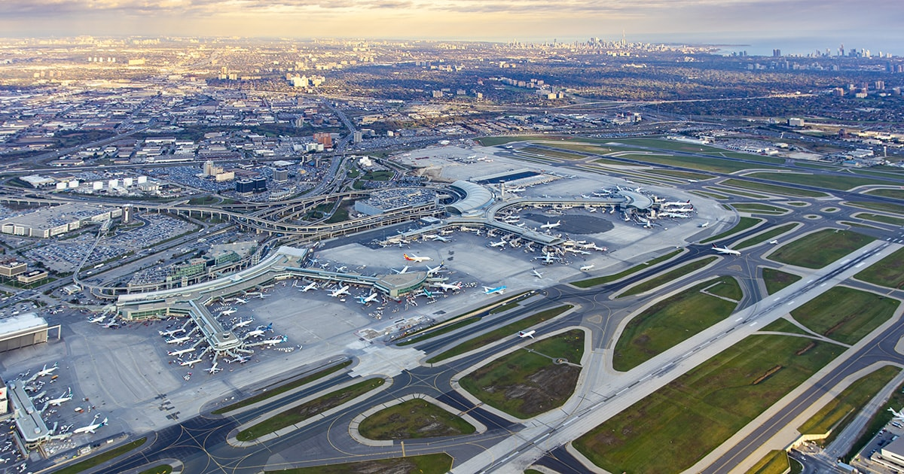
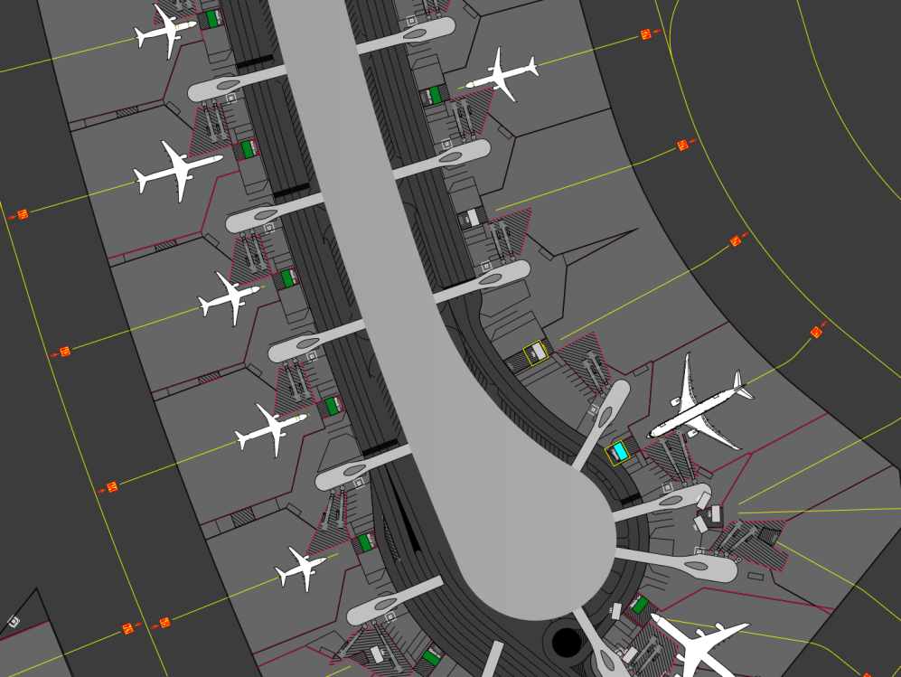

# Brock Solutions Airport Automation Challenge

### Theme: Message-Driven Operations at YYZ

Created by Engineering IDEAs Clinic co-op students.

## Table of Contents

- [Quick Links](#quick-links)
- [Your Mission](#your-mission)
- [Background Information](#background)
- [Sub-Problems](#sub-problems)
  - [Lost Baggage Recovery](#lost-baggage-recovery)
  - [Baggage Handling System](#baggage-handling-system)
  - [Gate Assignment](#gate-assignment)
  - [Passenger Clearance](#passenger-clearance)
  - [Aircraft Loading](#aircraft-loading)
- [Development Approach](#development-approach)
- [Submission](#submission)
- [Judging Criteria](#judging-criteria)
- [General Resources](#general-resources)

## Quick Links

> **Navigation tip:** Use the headings in this document to move quickly between sections. Screen reader users can navigate by heading level.

- [Lost Baggage Recovery challenge]
- [Baggage Handling System challenge](baggage-handling-system/README.md)
- [Gate Assignment challenge](gate-management-subproblem/README.md)
- [Group Check-in & Document Verification challenge](passenger-clearance-subproblem/README.md)
- [Aircraft Loading challenge](aircraft-load-subproblem/README.md)
- [Submission expectations](#submission)
- [Judging rubric](#judging-criteria)

> **Fact Disclaimer** All the information in this repo are estimates based on publicly available information. They are provided for illustrative purposes and should not be misconstrued as fact.

## Your Mission

Modern airports rely on connected systems to move passengers, aircraft, baggage, and staff safely and efficiently. Brock Solutions builds and integrates software for these real airport operations.

In this challenge, your team has been invited to prototype a software or software-adjacent solution for an airport automation problem. You may extend the supplied code, combine ideas from several sub-problems, or create a related solution of your own. Your solution should be realistic enough to connect to airport operations, but focused enough to prototype during the challenge.

Toronto Pearson International Airport (YYZ) is the recommended airline for this challenge, but you can build your solution for any airport of your choosing. An airport like Pearson handles about 128,000 passengers daily, and might route routing their luggage through a web of thousands of conveyors. This complicated web of passengers, luggage, flights, gates, need good software to manage. To build good software, think like an airport systems engineer:

- expect incomplete, late, or conflicting data
- consider safety, privacy, accessibility, and operational constraints
- build a simple working version before adding complexity
- explain the decisions and trade-offs behind your design
- show how your idea could connect to a larger airport system

Airport systems are message driven and closely connected. A passenger update in a Departure Control System can affect baggage handling, aircraft readiness, gate planning, and the operational information used by other teams. Your prototype does not need to model the whole airport, but it should understand where it fits.

As you make your solution this weekend, use the [judging criteria](#judging-criteria) to guide your decisions and demonstration.

## Background 

Airlines and airports have suites of software solutions to manage this complicated web of logistics. You can choose to solve your subproblem with these software solutions. Some common software suites are:
### BHS
A Baggage Handling System (BHS) identifies, tracks, routes, and sorts bags through scanners, conveyors, diverters, make-up areas, and carousels. A bad routing decision can delay a passenger, a flight, or an entire baggage pier. 

Examples of Baggage Handling Systems include SmartBag by Brock Solutions and Amadeus Solutions for Baggage Services. 
### GMS
A Gate Management System (GMS) assigns arriving and departing aircraft to airport gates. It must account for aircraft size, timing, gate equipment, passenger needs, customs rules, cargo restrictions, and disruptions such as delays or outages. 

Examples of Gate Management Systems include Better Stand & Gate by Copenhagen Optimization and ResourceManager by Assaia. 
### DCS
A Departure Control System (DCS) handles everything that must happen before a passenger, and an aircraft are ready to leave check-in, identity and document checks, baggage acceptance, seat assignment, boarding passes, boarding status, and aircraft load control. 

Examples of Departure Control Systems include: SmartLoad and SmartClear by Brock Solutions  
###
You can check out the software solutions from Brock Solutions here: [https://www.brocksolutions.com/airports-and-airlines/#]

## Sub-Problems
### [Lost or Misplaced Baggage](baggage-loss-subproblem/README.md)
other name ideas:
- baggage recovery
- baggage tracking
- lost or misplaced baggage <- current best
- baggage reconciliation
- baggage reconciliation and loss prevention

Bags can become separated from their owners for various reasons. As they move through the baggage handling system the tags can become damaged, losing the passenger/destination information, or they could be missing when loading the plane. Bags could also be swapped by bad actors, with the tag being removed and placed on a different bag. All ways of losing a bag cause distress to the passenger, as they have lost their personal belongings. This, in turn, causes a negative reputation and loss of money for the airlines and airport who handled the baggage.

#### Challenge

Your challenge is to design a system or software to aid in the tracking of bags, to aid in preventing loss and to help return bags to their owners.

#### Potential Solutions:
* SecureBag - Security against malicious attempts at switching baggage [[Supported]](baggage-handling-system/securebag/README.md)
* Privacy-conscious tracking that avoids unnecessary passenger personal information

Your solution may be software-only, hardware-assisted, simulation-based, or a mix of all three.

[Open the Baggage Handling System challenge](baggage-handling-system/README.md).

### [Baggage Handling System](#baggage-handling-system/README.md)

To get from check-in to airplane, baggage travels over a large system of conveyors. The bags are taken through security screening, then must be routed to the correct terminal to be loaded onto the plane. (add more details). To get the bag to the correct terminal, the conveyor system needs to know where the bag needs to end up, to track where it is, and to move it onto the correct conveyors. It does this for thousands of bags, all at the same time.
In addition to routing the bags, the conveyor system needs to have methods to detect foreign objects or people entering the conveyor system, to keep the people safe.

#### Challenge

Your challenge is to design a BHS that can identify, track, route baggage through a simplified baggage handling environment, and detect anomalies or foreign objects on conveyor systems to ensure operational safety.

#### Potential Solutions:
Control a real conveyor system to simulate bag movement through a network [[Supported]](baggage-handling-system/barcode-conveyor/README.md)
* Error handling for unreadable, oversized, overweight, fragile, or untagged bags
* Foreign object or anomaly detection on conveyor tracks
* Emergency stop, slowdown, or warning signals for conveyor operations
* Simulation of bag movement through a simplified conveyor network

Your solution may be software-only, hardware-assisted, simulation-based, or a mix of all three.

[Open the Baggage Handling System challenge](baggage-handling-system/README.md).

### [Gate Assignment](gate-management-system/README.md)

#### The Problem

At Toronto Pearson Airport, a sudden gate malfunction forces an arriving aircraft to wait on the taxiway during a busy long weekend. Due to slow gate reassignment, passengers are left stuck on board. This leads to passengers missing connections and appointments. Inside the airport, crowds swell as other flights are also delayed, creating long walking distances and overwhelming staff. The airline ends up having to spend a significant amount of money on compensation and rebooking flights. The airline and airport are bombarded by complaints from very angry passengers from their customer service lines and on social media. 

#### Challenge
Ideally, this is a scenario that airports want to avoid. As such, your challenge is to develop a solution that assigns airport gates to arriving and departing flights over time. Your solution must:  
- Respect aircraft-gate compatibility
- Handle airline preferences and security concerns
- Adapt dynamically to delays, outages and emergencies (cascading changes)
- Minimize conflicts, delays and wasted time (optimization) 

#### Potential Solutions:
  * Greedy scoring-aware assignment algorithm [Supported](gate-management-system/solution_scored.py)
  * First-fit baseline algorithm [Supported](gate-management-system/solution_firstfit.py)
  * Disruption repair (delay, outage, equipment swap) [Supported](gate-management-system/solution_scored.py)
  * Operator dashboard / interactive timeline visualizer [Supported](gate-management-system/visualize.py)
  * Scenario analysis across busy/emergency/cargo/overnight cases [Supported](gate-management-system/visualize.py)
  * Security/restricted gates (origin-specific secure gate rules)
  * Airline gate preferences (soft-reward scoring)
  * Turnaround service buffer between aircraft at same gate
  * Constraint-solver (ILP/CP-SAT) replacement for greedy heuristic
  * Predictive disruption handling from historical delay patterns
  * Adversarial scenario generator to stress-test beyond fixed scenarios
  * Assignment explainability layer ("why gate X for flight Y")
  * Live what-if simulator for manual override impact

#### Starting Point

This is the most structured coding subproblem. You may write your own assignment algorithm or build a larger tool around the supplied baseline.

[Open the Gate Assignment Subproblem](gate-assignment-subproblem/README.md).

### [Group Check-in & Document Verification](group-check-in-&-document-verification-subproblem/README.md)

#### The Problem
A school group of 32 passengers arrives at the airport to check in for the same flight less than an hour before the check-in deadline. Although the passengers are travelling together, each person has different document requirements, seat assignments and baggage information. Most passengers are cleared immediately, but several require additional document review. 

Processing every passenger individually creates a long queue and increases the risk that the group will not complete check-in on time. However. Treating the entire group as one unit could cause individual document or baggage issues to be overloaded. Staff need a way to see which passengers are ready, which require attention and what issues remain unsolved. 

#### Challenge
Your challenge is to develop a solution that helps airport staff process large groups efficiently while maintaining accurate clearance information for each individual passenger. 

#### Potential Solutions:
  * Unified identity gateway: booking, doc checks, seat, bag declare, boarding pass, agent review, audit
  log [Supported](departure-control-system/README.md)
  * Passenger-processing checkpoint monitor
  * Document-review assistant w/ mismatch confidence scoring
  * Baggage reconciliation linking declared bags to scan events
  * Override/audit-log analytics for staff workload + rule-override patterns
  * Accessibility-first check-in flow variant

[Open the Passenger Clearance Subproblem](passenger-clearance-subproblem/README.md).

### [Aircraft Loading](passenger-clearance-subproblem/README.md)

#### The Problem
A mechanical issue causes the airline to replace the originally scheduled aircraft with a smaller aircraft shortly before departure. The new aircraft has different seating, baggage capacity and weight-and-balance-limits. 

Passengers have already checked in, seats have been assigned, and baggage is being prepared for loading. Because the new aircraft has less capacity and different loading constraints, the existing passenger and baggage plan can no longer be used directly. Staff must quickly determine how to recognize passengers, baggage and available capacity while avoiding unnecessary delays. 

#### Challenge
Your challenge is to develop a solution that quickly adapts the existing passenger and baggage plan to the replacement aircraft while maintaining safety weight-and-balance limits and minimizing operational disruption. 

#### Potential Solutions:
  * Aircraft load control (weight/balance zone assignment) [Supported](departure-control-system/README.md)
  * Baggage reconciliation linking declared bags to scan events
  * Flight-close readiness aggregator (identity + load + baggage in one score)
  * Override/audit-log analytics for staff workload + rule-override patterns
    
[Open the aircraft-load-subproblem](aircraft-load-subproblem/README.md).
## Development Approach

1. Choose one clear operational problem.
2. Run or inspect the supplied example before changing it.
3. Build the smallest complete version of your idea.
4. Add validation and handle a few meaningful edge cases.
5. Test the same inputs before and after each change.
6. Add one distinctive feature if time allows.
7. Prepare a short demonstration and explain your trade-offs.

A reliable, understandable prototype is stronger than several unfinished features.

## Submission

Teams will give a short presentation of about 3 to 5 minutes. Include:

- the problem you chose and who it affects
- how your solution works
- the prototype, simulation, dashboard, or hardware demonstration
- the constraints and edge cases you considered
- the result you achieved
- what you would improve with more time

Your submission may include code, a dashboard, a simulation, a hardware and software demonstration, a design with partial implementation, or a combination of these.

## Judging Criteria

### Ideation

| Category | What judges are looking for | Score |
| --- | --- | --- |
| Relevance | The solution addresses a meaningful airport problem. | /3 |
| Reasonability | The idea and assumptions are sensible. | /3 |
| Impact | The solution could help its intended users or stakeholders. | /3 |

### Feasibility

| Category | What judges are looking for | Score |
| --- | --- | --- |
| Cost | The cost to build and operate the solution is realistic. | /3 |
| Return on investment | The expected benefit is worth the effort and cost. | /3 |
| Practicality | The solution could fit into a real operational environment. | /3 |
| Reliability | The design considers failures, recovery, and downtime. | /3 |

### Prototype Execution

| Category | What judges are looking for | Score |
| --- | --- | --- |
| Functionality | The prototype works during judging. | /8 |
| Build quality | The implementation or physical prototype is well made. | /3 |
**| Effort and process? | How much work did the students put in? What was their capability level before the hackathon? Did they use helpers? (eg. AI, provided solutions) | /3 |

### Safety and Regulations

| Category | What judges are looking for | Score |
| --- | --- | --- |
| Employee and operator safety | The design accounts for risks to workers and users. | /3 |
| Regulatory awareness | The team identifies relevant Canadian or international requirements. | /3 |

### Demo and Presentation

| Category | What judges are looking for | Score |
| --- | --- | --- |
| Clarity | The team explains the problem and solution clearly. | /5 |
| Depth | The team shows meaningful understanding of the problem. | /5 |
| Demo | The demonstration makes the result easy to understand. | /5 |

Coding subproblems may also use hidden test cases to check whether solutions work beyond the visible examples.

## General Resources

Depending on the subproblem, the repository includes starter code, JSON messages, schedules, airport data, demo scripts, evaluators, simulations, and reference implementations. Do not assume the visible examples cover every case.

Useful topics and tools include:

- airport systems integration and event-driven software
- optimization, simulation, and visualization
- `numpy`, `pandas`, `matplotlib`, `scipy`, `networkx`, `simpy`, and `pulp`
- Canadian Aviation Security Regulations and Canadian accessibility requirements
- International Air Transport Association (IATA) and International Civil Aviation Organization (ICAO) guidance

You may use other tools when they are appropriate for your solution. Reference external data, libraries, and research clearly in your final documentation.
